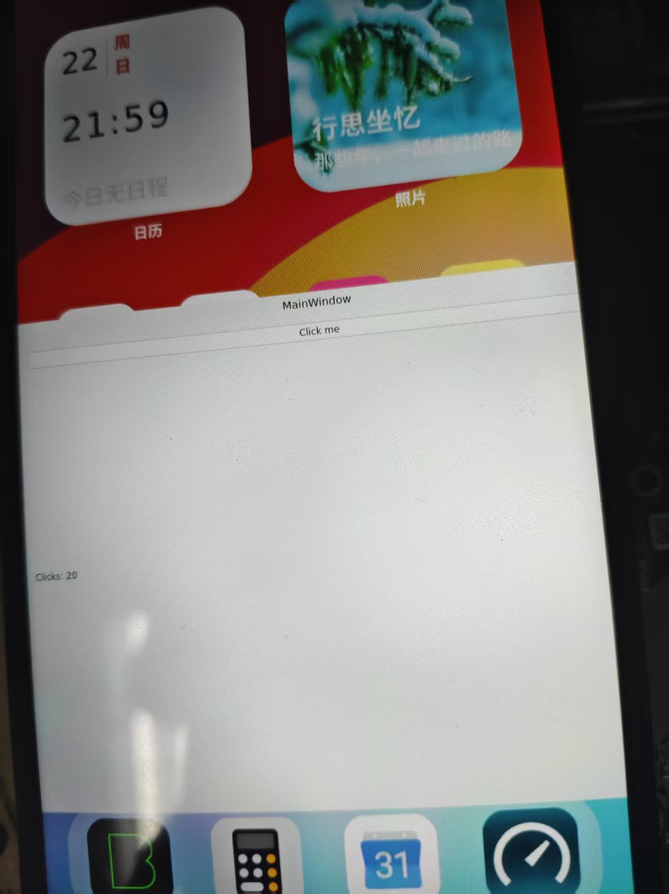
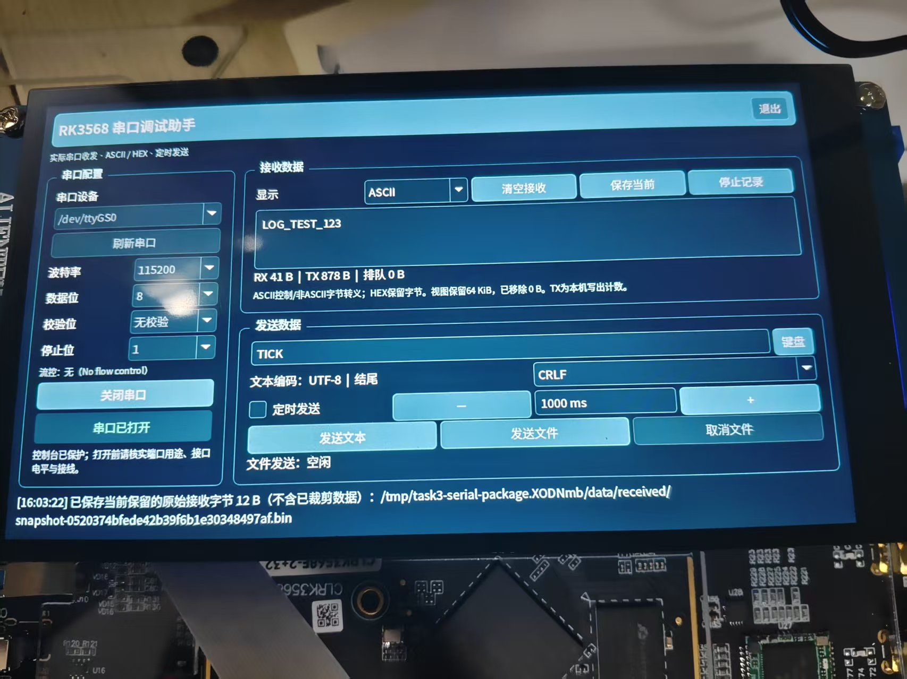
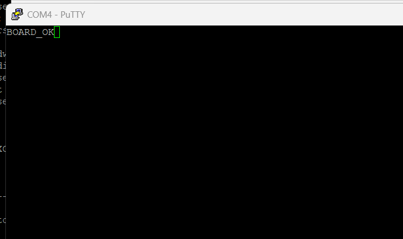
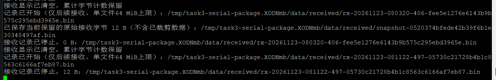
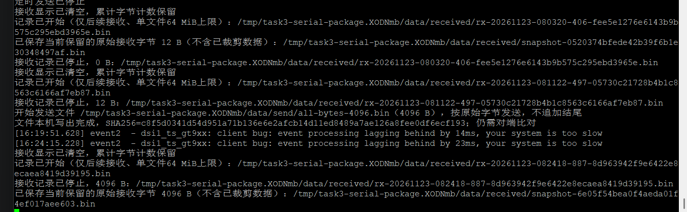
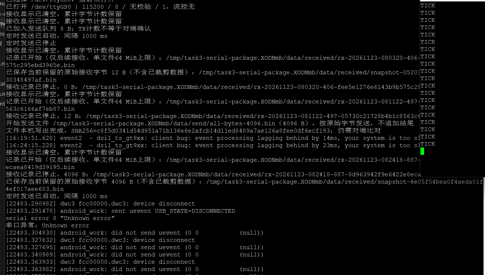
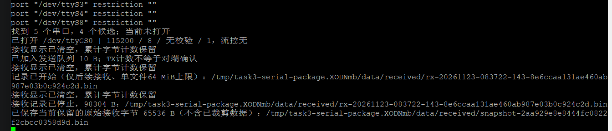
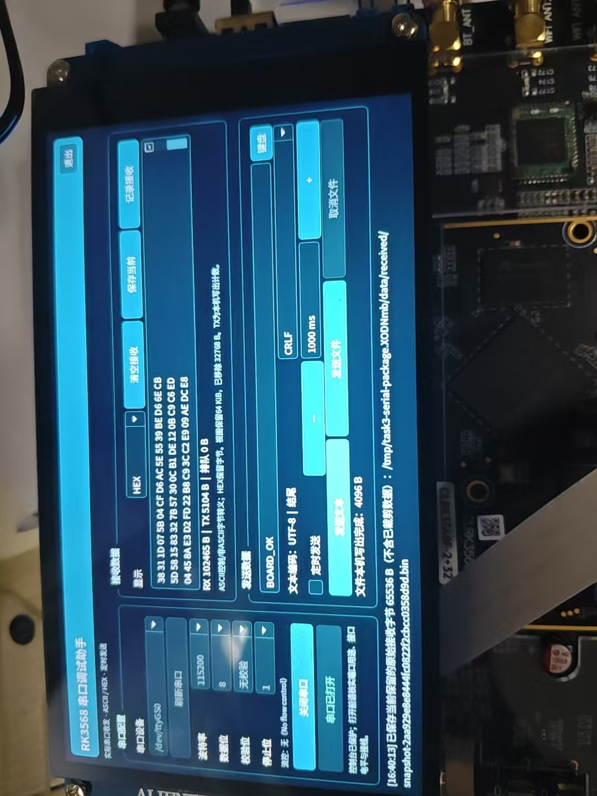

# 任务03 RK3568 Qt串口助手调试与验收报告

## 项目结果

日期：2026-11-23。应用以Qt5.15.2/C++11和QtSerialPort实现，在ATK-DLRK3568开发板的LCD上运行。已完成本轮主要功能验证，验证通道为电脑COM4与板端/dev/ttyGS0之间的真实OTG CDC ACM链路，COM3继续作为调试控制台。

本报告区分“代码实现”“实际通过”和“尚未验证”。完整需求状态见[验收矩阵](../requirements-status.md)。图片均来自用户本次调试反馈，原图复制保存，无生成、裁剪或内容改写；原始文件来源和哈希见[图片清单](images/sources.json)。部分实物照片保留拍摄方向。

## 环境与构建基线

|项目|已确认配置|
|---|---|
|开发主机|Ubuntu22.04.5 LTS x86_64，Qt Creator6.0.2|
|交叉SDK|厂商Qt5.15.2，GCC/G++10.3.0，aarch64-buildroot-linux-gnu|
|板端|ATK-DLRK3568，aarch64，Buildroot2018.02-rc3，Linux4.19.232|
|图形|现有Weston/Wayland，Noto Sans SC中文字体|
|显示与输入|DSI LCD1080×1920，应用逻辑表面720×1280，触摸实际可用|
|应用横屏|仅应用内旋转；默认+90°，--rotate-left为-90°；不改系统显示配置|
|测试端口|Windows COM4 ↔ 板端ttyGS0，115200/8/N/1、无流控|

选做功能版15:20:31在Qt Creator编译正常结束，随后部署至/tmp/task3-serial-package.XODNmb/qt_demo。产物SHA256：

`b48ea44b8804ada462a880e693cbdb770b90663d6997827b50673a6a858790f7`

板端依赖检查无缺失，10项串口数据规则自检与14项文件I/O自检均通过。自检不打开串口，不能取代后文真实收发。[部署及自检证据](../evidence/script-20261123-152436-a2cf8278/deployment.json)。

## 调试过程与实机证据

### 基础Demo与触摸链路

基础窗口、按钮和计数标签先在板端运行。用户触摸20次，标签与终端计数一致，证明交叉编译、部署、图形显示和触摸事件链路可用。用户明确取消10分钟等待，本报告不补记该持续观察通过。

图1：基础Demo实物照片；[运行日志](../evidence/demo-validation/run-at-20.log)。

### 完整助手界面与功能入口

串口参数、接收模式、发送文本、定时发送、发送文件、日志和快照入口均在同一应用内。串口打开后锁定参数；关闭后发送控件禁用，重新打开恢复，用户已确认。照片中记录仍在进行，仅说明该拍摄时刻的界面状态；最终日志结果依据后面的停止日志和文件核验。

图2：应用在LCD显示；ASCII中的LOG_TEST_123是12 B，不是11 B。RX是累计值，清空显示不清累计计数。

### 双向文本与显示切换

电脑输入PC_OK，板端ASCII显示一致，HEX为50 43 5F 4F 4B。板端发送BOARD_OK，电脑COM4实际收到；该方向以对端内容作为证据，不仅依赖本机TX计数。随后实际二进制显示也完成ASCII/HEX切换，用户确认计数不因切换改变。

图3：电脑端接收证据。ASCII模式将控制字节及非ASCII字节转义为\xNN等表示；这些转义不是乱码，HEX模式保留字节含义。应用发送文本采用UTF-8，接收ASCII视图不承诺任意编码的中文自动解码。

### 定时发送与停止

设置TICK、CRLF和1000ms后，电脑逐行接收。用户取消勾选后确认停止。每次发送为6 B；截图仅用于确认持续发送行为，未采集精确到达时间戳，不宣称周期误差已达某个指标。

图4：定时发送实际接收。自动发送在关闭/异常后停止，重开串口不会自行恢复。

### 文本日志和快照

开始记录后再发送LOG_TEST_123，停止后生成12 B原始日志，JSON元数据state=user_stopped。日志和快照均取回电脑核对，内容完整一致。

图5：最后一项是正确顺序重测得到的12 B日志。前面的0 B旧记录保留为过程证据，不覆盖或计为成功。

文本样本SHA256：`fe0cc22f669cdc2d2d50c426a97c06b8c30e4adba2c150458473a57dfeed5e67`。原始文件见[文本日志证据目录](../evidence/otg-log-test/)。

### 双向二进制与文件发送

测试文件all-bytes-4096.bin由00～FF重复16次组成。板端“发送文件”发送原始4096 B，电脑保存并逐字节比较一致；发送不额外追加文本设置中的CRLF。随后电脑向板端发送同一文件，板端完整日志和快照也均为4096 B且逐字节一致，日志最终元数据核验通过。

图6：文件发送本机完成及接收日志/快照完成提示；对端和落盘比对见下表，而非仅凭这些提示判断准确性。

|方向/产物|结果|机器核验记录|
|---|---|---|
|板端文件→电脑|4096 B，逐字节一致|[接收结果](../evidence/otg-file-test-20261123-161729/result.json)|
|电脑→板端完整日志|4096 B，逐字节一致，元数据正确|[核验结果](../evidence/otg-binary-rx-20261123-162517/verification.json)|
|电脑→板端接收快照|4096 B，逐字节一致|同上|

这三份数据与源文件SHA256均为`c8f5d0341d54d951a71b136e6e2afcb14d11ed8489a7ae126a8fee0df6ecf193`。电脑接收测试的96.32秒包含等待用户点击，不是文件传输耗时。

### OTG热拔插与手动恢复

定时发送期间拔除OTG数据线，内核报告USB断开，应用捕获serial error 8并报告串口异常。用户确认板端关闭串口；插回后手动重开，板端收到RECONNECT_OK，电脑收到BOARD_OK，定时发送保持关闭。

图7：异常日志中的Unknown error是底层描述，不能据此认定程序崩溃。后续手动恢复由用户真实反馈确认；[原始运行日志](../evidence/otg-hotplug-test/otg-run-disconnect.log)。OTG拔线后ttyGS0节点可能仍存在，本项不等同USB转串口设备节点消失测试。

### 接收缓存边界与日志完整性

电脑发送98304 B固定样本，每块4096 B、块间50ms。板端日志保存全部98304 B；视图只保留最新65536 B，显示已移除32768 B。取回快照与源数据最后65536 B逐字节一致，完整日志与全部源数据一致。用户仍能停止记录、保存文件，随后确认ASCII/HEX切换和串口开关正常。

图8：98304 B完整记录与65536 B快照，数值符合预期。

图9：LCD显示“已移除32768 B”，这表示视图裁剪，不是原始日志丢失。[逐字节核验](../evidence/otg-rx-boundary-20261123-163828/verification.json)。

|产物|字节数|SHA256|
|---|---:|---|
|完整接收日志|98304|1d765a4fcc22cad7cc15d298ec99ad6d4ec0cff8dabed3a1f0d7c598d7c049e0|
|尾部接收快照|65536|13c344d2ae5c41cc5aec8b55c5aef474f9124200659252f8556321f2e061e77b|

## 结果边界与未完成项

本轮证明已测OTG链路中的真实收发、日志、文件和缓存行为正确，不证明RS-232电气连接、硬件UART不同参数组合或长期满速稳定性。仍待真实验证：端口不存在、权限不足、文件取消/大容量存储异常、约定的持续负载、Ubuntu一键构建脚本实跑。用户取消过Demo的10分钟观察，不把它重新列为必须重做的步骤。

运行日志出现两次触摸事件处理滞后14ms/23ms，已保留；未观察到这些提示伴随本轮数据校验失败，但没有据此宣称所有性能问题已排除。24项自检包含容量和短写等逻辑验证，不能替代真实磁盘故障实验。

## 交付内容与使用入口

工程与环境见[交付指南](../delivery-guide.md)，日志/文件操作见[选做功能说明](../optional-features.md)，当前范围见[需求状态](../requirements-status.md)。Ubuntu命令集中在任务commands.txt；板端启动步骤通过聊天提供。主机代码、工具、图文报告和测试证据均在任务03目录，按用户授权整理后发布至GitHub。
