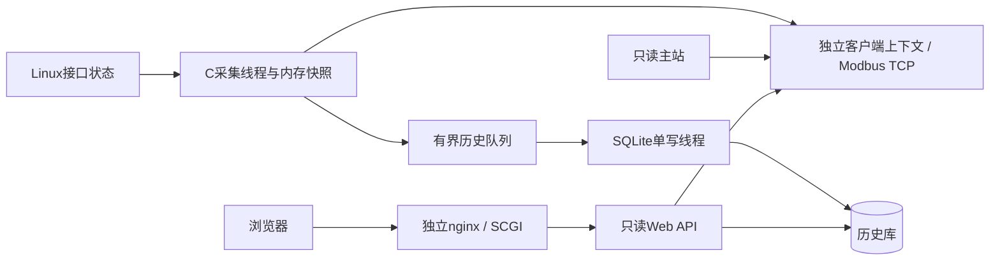

# 架构、状态来源与数据所有权

## 进程和线程

status_server主线程约每秒采样；最多4个客户端各持独立libmodbus上下文和映射，复制同一只读快照。Web实时API也会占用TCP连接，所以3个外部长期连接可留一个名额。多字段采集是依次读取，保证响应内存快照一致，不声称所有硬件字段在同一纳秒采样。

## 状态含义

carrier/IP/驱动字节与错误计数来自系统；Wi-Fi信号优先使用驱动接口，不可用时尝试iw，未知值清有效位。驱动统计包含全部接口流量，不是Modbus独占统计；Wi-Fi carrier不代表互联网可达。未核实Ethernet速率时不借用无线信号或速率填充。

serial_open只表示本应用是否持有UART，不能代表PuTTY或内核通用串口状态。当前RTU禁用，串口字段为0。系统实时钟可未同步；单调时钟用于快照年龄，session与counter_epoch用于区分重启和观测到的计数回退。

同一网络断开时不能经这条断开的网络报告自身断网；当前无RTU备用链路，不夸大故障可观测性。

## SQLite历史

SQLite是嵌入式库，不需要单独数据库服务。采集路径只复制到64项有界队列，单写线程执行短事务；WAL、FULL同步和检查点用于本地持久目录。周期采样以及连接/IP/有效位/计数epoch变化可触发记录，不把每次信号数值变化都称为事件。

历史与实时来源独立。实时服务不可用时Web返回503并清空实时数值，历史仍可查询；不得把最近历史当实时。分页最多50条，曲线按样本顺序，跨会话或未知值断线，横轴不假装等间隔真实时间。

有数据库大小限制、队列/写入故障标志，但未形成完整长期保留/备份恢复方案。FULL或已写入SQLite不保证任意掉电零丢失；本轮没有断电实验。

## Web配置

配置使用独立config.db，由config_api单写；状态服务启动时加载。只读站与127.0.0.1管理站分离，管理经SSH转发使用随机令牌；令牌保留内存，不写URL/浏览器持久存储。POST检查Origin、类型、完整参数与revision；无令牌401、来源不符403、非法值400、旧revision409。

保存成功不等于已生效：saved/runtime分别展示。Unit1→7、历史10→2秒在重启本任务采集进程后加载；115200只是串口保存值，RTU仍禁用。无IP修改、自动重启按钮或自动回退。单管理员令牌不是多用户权限系统。
